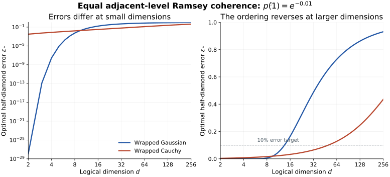

# Bosonic Phase Memory

**How accurately can one oscillator preserve an arbitrary quantum register through an unobserved phase-noise interval, even with the best possible encoding and recovery?**

For a logical register of dimension $d$ and a phase density $p$ that is symmetric about zero and nonincreasing on $[0,\pi]$, the exact answer is the probability in one angular cell of width $2\pi/d$. A known symmetry center can first be rotated to zero:

```math
\begin{aligned}
w_d(p)&=\int_{-\pi/d}^{\pi/d}p(\theta)\,d\theta,\\
\sup_{\mathcal E,\mathcal R}F_e(\mathcal R\mathcal D_p\mathcal E)
&=w_d(p),\\
\inf_{\mathcal E,\mathcal R}\frac12
\|\mathcal R\mathcal D_p\mathcal E-\operatorname{id}_d\|_\diamond
&=1-w_d(p).
\end{aligned}
```

The optimization allows arbitrary deterministic encoders and recoveries, with no photon-number limit. The oscillator is the only quantum memory through the interval; no external record reveals the realized phase, and no correction occurs during the interval. Retained classical encoding records do not improve the optimum.

The converse applies to every allowed code. A finite-support number-phase construction approaches it, with its full logical channel converging to an explicit mixture of logical phase errors. If the density is continuous and strictly decreasing on $(0,\pi)$ and $d>1$, the limiting optimum is not attained by a normal code. The [number-phase construction is inherited](science/06-prior-work.md); the claim developed here is its exact universal optimum in this operational model.

## Main results

| Result | Meaning | Authoritative account |
|---|---|---|
| Exact fidelity and diamond benchmark | More oscillator energy cannot eliminate the phase-alias error at fixed register dimension and noise law. | [Theorem and converse](science/02-exact-benchmark.md) |
| Explicit finite-support decoder | Quotient-and-remainder decoding extracts modular phase without measuring the logical state. | [Achievability](science/03-constructive-achievability.md) |
| Quantified finite-energy approximation | Flat and sine envelopes give explicit convergence estimates; the sine envelope gives a quadratic rate in its length for smooth densities. | [Finite resources](science/04-finite-resources.md) |
| Controlled photon-loss penalty | A cutoff-dependent exact loss-distance bound and a sharper bound for the explicit codes give finite-resource guarantees under joint noise. | [Loss robustness](science/04-finite-resources.md) |
| Exact dependence on the phase law | Equal adjacent-level Ramsey coherence need not imply equal optimal logical error, and the ordering can depend on register size. | [Noise laws and architecture](science/05-noise-laws-and-architecture.md) |

The finite-energy estimates are constructive guarantees. They do not claim global optimality at fixed energy or an exact solution of joint loss and dephasing.

## Read the science

Start with the [memory task, model, and error measures](science/01-model-and-question.md). The [science map](science/README.md) connects the proofs, constructions, resource estimates, and physical interpretation.

The central proof has two parts. Uniform phase averaging completely dephases the oscillator's nondegenerate number basis and is entanglement breaking. This places an integral budget on every code's fidelity response. A concentration bound then selects the central phase cell. The matching code resolves phase modulo that cell, and its unresolved aliases give the exact limiting error.

| Reader question | Route |
|---|---|
| What exactly is optimized, and which side information is excluded? | [Model and question](science/01-model-and-question.md) |
| Why can no other encoder do better? | [Universal converse](science/02-exact-benchmark.md) |
| What is the actual encoder, measurement, and recovery? | [Constructive achievability](science/03-constructive-achievability.md) |
| How much photon support is sufficient, and what changes with loss? | [Finite-resource bounds](science/04-finite-resources.md) |
| What does this imply for register size and storage time? | [Noise laws and architecture](science/05-noise-laws-and-architecture.md) |
| Which ingredients are established, and which comparison is new? | [Prior work](science/06-prior-work.md) and [bibliography](references/references.bib) |
| Which calculations can be reproduced? | [Verification](verification/README.md) |

## Learn the project

The educational anchor is **Steven M. Girvin, [Introduction to Quantum Error Correction and Fault Tolerance](https://arxiv.org/html/2111.08894v4)**, *SciPost Physics Lecture Notes* 70 (2023). The [Girvin-to-project bridge](learning/girvin-bridge.md) selects the relevant sections, translates notation and assumptions, and supplies the steps needed to reach the phase-memory theorem.

The [30-milestone map](learning/milestones.md) has two connected phases: **12 background milestones** build the physical and operational model; **18 narrative milestones** develop the converse, matching construction, resource bounds, and architectural meaning. The targets belong to the project and apply to any reader.

Start at the [learning entrypoint](learning/README.md) for the guided route, or use the [scientific reading guide for LLMs](llms.txt) to locate authoritative statements and preserve the distinctions between the exact optimum, finite constructions, and physical implementation.

## A measurable coherence does not determine the whole memory



These two phase laws have the same adjacent-level Ramsey coherence, $\widehat p(1)=e^{-0.01}$, but their exact optimal register errors differ and their ordering reverses as the logical dimension grows. The [noise-law analysis](science/05-noise-laws-and-architecture.md) gives the formulas and qualifications; the [CSV](figures/equal_ramsey_error.csv) contains the plotted values.

## Reproduce the finite calculations

From the repository root, with Python 3.10 or later:

```sh
python3 verification/check_finite_resources.py
```

The calculation checks use the standard library. The [verification guide](verification/README.md) explains the independent formulas compared, records the expected output, and gives the plotting command and pinned dependency. Finite numerical checks complement the written proofs.

## Scope

The exact theorem concerns one oscillator, one unobserved random phase interval, a known symmetric unimodal density, and preservation of the entire logical register, including entanglement with an inaccessible reference. It is an energy-unconstrained benchmark approached by finite-energy codes.

Two modes under the same collective phase have degenerate fixed-total-number subspaces and can evade the single-mode bound. External phase information, continuous correction, and arbitrary multimodal phase densities change the problem. The [model](science/01-model-and-question.md) and [physical interpretation](science/05-noise-laws-and-architecture.md) explain these boundaries.

## Purpose and contact

This repository serves as a record of the work and a guide for the author’s self-directed learning. For discussion or potential collaboration, please contact Ruge Lin at [gogoko699@gmail.com](mailto:gogoko699@gmail.com).
